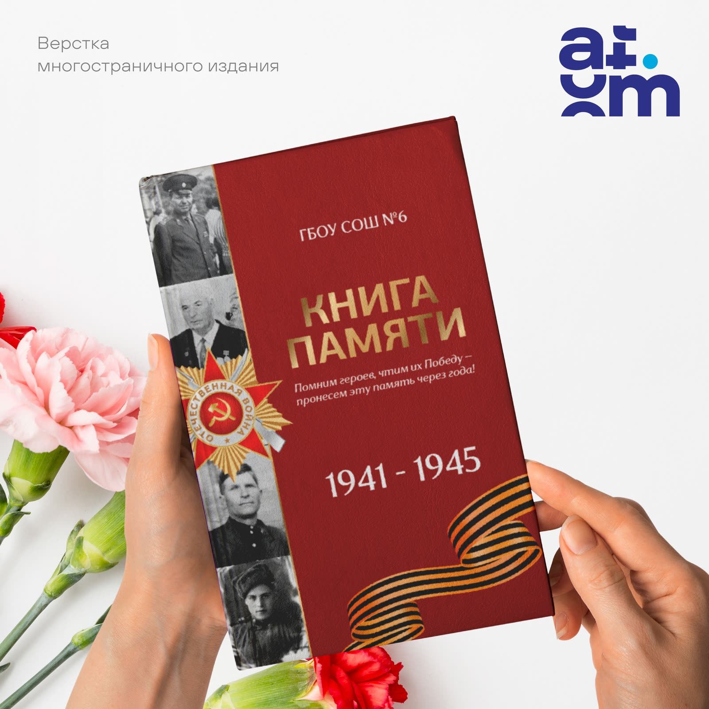
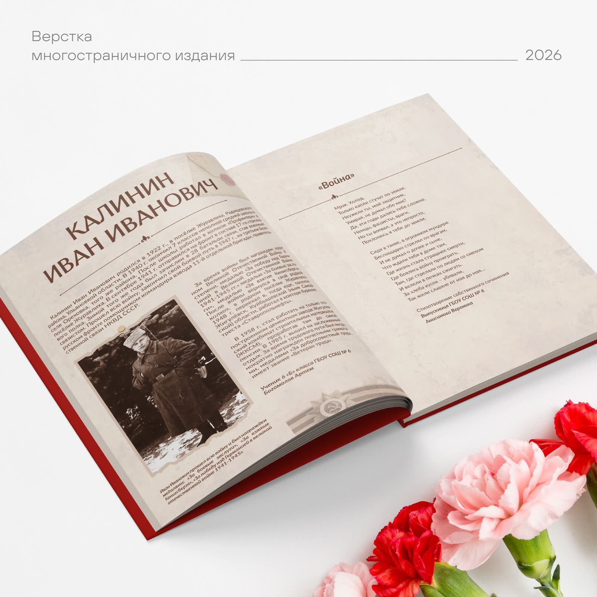

В преддверии 9 мая хочется не просто купить цветы к памятнику, но и сохранить историю своей семьи. Для многих из нас «Книга Памяти» — это неофициальный архив, где собираются лица и имена тех, кто воевал или работал в тылу. Но часто старые фотографии хранятся в хаотичных альбомах, а воспоминания ветеранов теряются в повседневной суете.
  

  
Мы занимаемся версткой многостраничных изданий, которые превращают разрозненные снимки и документы в единый, крепкий и аккуратный сборник. Важно, чтобы на выходе получилась не просто брошюра, а именно книга — солидная, аккуратная, которую приятно держать в руках и передавать детям.В преддверии Дня Победы такое издание становится не просто подарком для пожилых родственников, а способом остановить мгновение и сказать спасибо. Это тихий, но очень прочный памятник, который всегда будет стоять у вас на полке.

